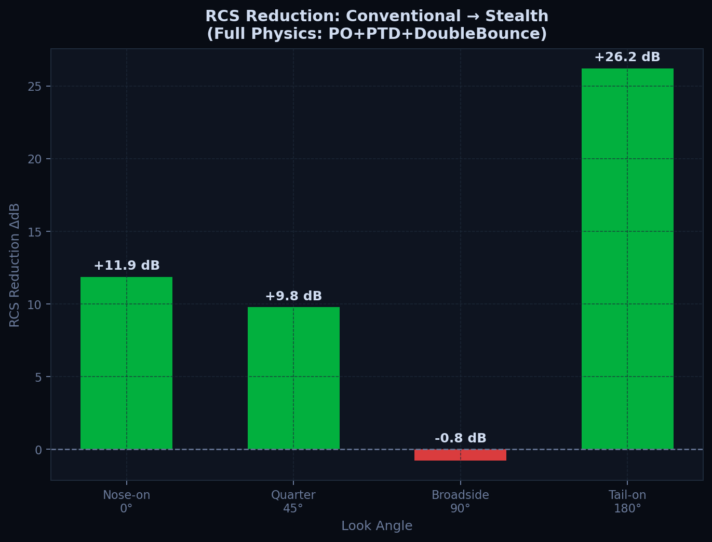
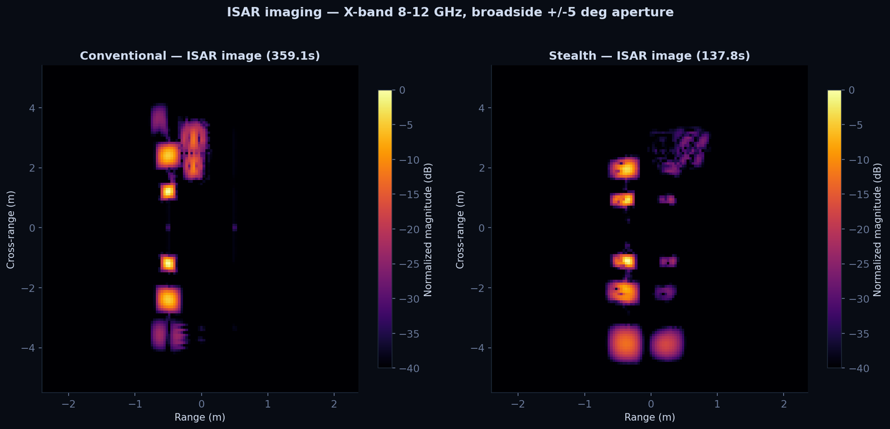
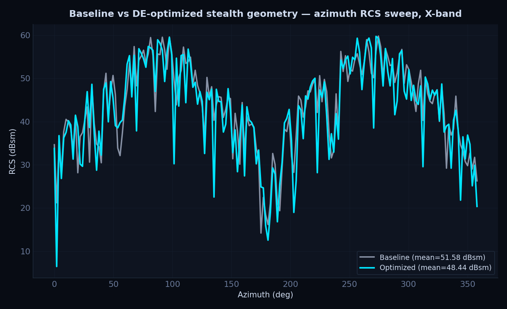
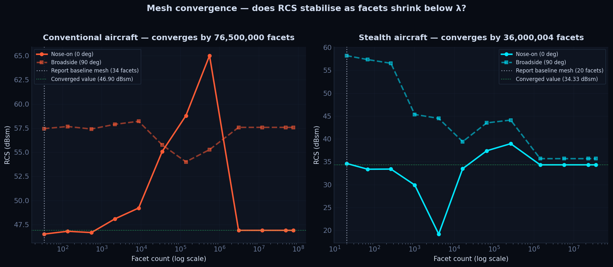
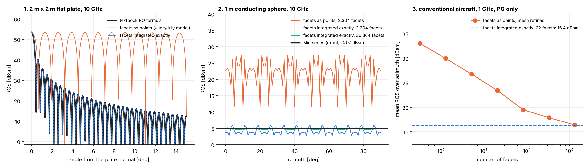

# Radar cross section of stealth shapes, from scratch

How strongly does an aircraft send radar back, and why do stealth aircraft look the way they do? We worked
it out for four hand-built aircraft, one conventional and three stealth-inspired, with Physical Optics
written from first principles in Python.

Project Based Learning in Avionics (AS363IA), 6th semester B.E. Aerospace Engineering,
RV College of Engineering, Bengaluru, 2025–26<br>
**Akula Uday Kiran · Shanthosh K V · Tejas L**<br>
Guided by Dr. Rachana Akki (Dept. of Electronics and Electrical Engineering) and
Dr. Karthik Vel E (Dept. of Aerospace Engineering)


## How it went

Radar cross section and stealth technology were a complete mystery to us when we picked this, so we just
went with it. We built the whole thing with the free version of Claude, try after try, and learnt the
physics as the code grew. The first try (12 June 2026) did Physical Optics on a few shapes and checked a
sphere against the Mie series. On 14 June it gained bistatic sweeps and two more aircraft, and then, the
same day, edge diffraction, double bounces and radar-absorbing materials. By 20 June it had become the
program in [`history/2026-06-20-june-final`](history/2026-06-20-june-final), and on 23 June we wrote the
first report.

In July Shanthosh took it much further with another AI agent: bistatic and polarimetric scattering, triple
bounces, surface-impedance materials, a shape optimizer, wideband range profiles, ISAR images, and a
mesh-convergence study for each. That version went into the final report, slides and poster
(17 July 2026, in [`report/`](report)).

It was a crazy exploration, completely new and awesome, and we learnt things we never would have if we had
stuck to a generic project.

In November 2026, while putting it on GitHub, we checked the solver against answers that are known
exactly. Some of what we had presented did not hold up. What we found, what we fixed and what is still
rough is [below](#what-we-checked-in-november-2026). The code and figures from June and July are kept as
they were.

## What the program does

- Builds each aircraft from a few dozen flat triangles (facets).
- **Physical Optics (PO):** every facet the radar can see reflects like a small mirror, and the returns
  are added with their phases.
- **Edges and corners:** a simplified edge-diffraction term (from the Physical Theory of Diffraction) and
  double and triple bounces between facets.
- **Radar-absorbing materials:** Salisbury screen, Dallenbach layer, and surface-impedance (SIBC) skins.
- Sweeps over azimuth, elevation and frequency; bistatic and polarimetric scattering; wideband range
  profiles and ISAR images; a differential-evolution optimizer for the stealth shape.
- The exact Mie series for a conducting sphere, as the reference.

## What we presented (June and July 2026)



The headline was that the stealth aircraft returned 11.9 dB less than the conventional aircraft nose-on,
which would cut a radar's detection range from 200 km to 100 km. The report also said the PO solver
matched the Mie series for a sphere to within 0.2 dBsm. Neither holds up; see below and the
[errata](report/README.md#errata).

The July studies, as made then:

<p>




</p>

More: [bistatic](figures/july/bistatic.png), [materials](figures/july/sibc-materials.png),
[range profile](figures/july/range-profile.png), and from June the
[polar plot of all six shapes](figures/june/polar-all-shapes.png),
[heatmaps](figures/june/heatmap-conventional.png), [absorbers](figures/june/ram-absorption.png),
[Salisbury screen](figures/june/salisbury-screen.png), [edges](figures/june/edges-stealth.png) and
[frequency sweep](figures/june/frequency-stealth-nose.png).

## What we checked in November 2026



1. **The sphere check had never passed.** The Mie series had a factor-of-4 slip (2n + 1 where
   n + ½ belongs), so for a 1 m sphere at 10 GHz it gave 10.99 dBsm instead of πa² = 4.97 dBsm. PO on the
   project's 2,304-facet sphere gave anything from 11.5 to 27.3 dBsm. *Fixed:* the Mie series gives
   4.97 dBsm, and PO now gives 2.9 to 6.0 dBsm on the same mesh and 4.7 to 5.2 on a 36,864-facet mesh
   (panel 2).

2. **Each facet was treated as a point.** The PO sum put a facet's whole area at its centre with a single
   phase. That only works for facets much smaller than a wavelength, and ours are 20 to 400 wavelengths
   across at 10 GHz. A big flat facet should send a narrow beam back when it faces the radar and very
   little otherwise; as a point it sent its full strength back from almost every angle. *Fixed:* the phase
   is now integrated exactly over each triangle (Gordon's closed form). A 2 m flat plate now follows the
   textbook formula exactly: 36.1 dBsm at 0.5° off normal and 21.6 dBsm at 5°, where the point model gave
   44.2 and 52.8 (panel 1).

   This is also what Shanthosh's July convergence study was seeing: as the facets were cut finer, the
   answers moved by more than 20 dB before settling, at millions of facets. For the conventional aircraft
   they settled at 46.9 dBsm (azimuth 0) and 57.6 dBsm (broadside), the same values the exact integral
   gives on the original June mesh. Panel 3 shows the same thing at 1 GHz, where the point model can get there
   with fewer facets. The stealth aircraft's azimuth-0 curve settled on a wrong value, because
   subdivision never splits its four nose triangles, so they were still points at the finest mesh.

3. **Azimuth 0 wasn't nose-on for every aircraft.** The models point their noses along −x and the program
   called azimuth 0 nose-on, but it put the radar on the +x side, behind the tail. Which side of a facet
   reflects depends on the order of its corners, and that was mixed: half of the stealth aircraft's facets
   and 16 of the flying wing's 28 faced inwards, which for the stealth aircraft happened to turn the view
   back to the front. The conventional aircraft also had a second copy of its flat nose face, facing into
   the fuselage. So "nose-on" meant the conventional aircraft seen from behind, plus that extra face,
   against the stealth aircraft seen from the front. *Fixed:* the radar direction, the duplicate face, and
   every facet's orientation (each now faces the side it can be seen from, found by casting rays).

4. **The double-bounce term counted bounces that can't happen.** It checked which way two facets faced but
   not where they were, so any pair at the right angles counted as a corner reflector. A plain 2 m cube
   cannot bounce a ray from one face to another, yet at 20°, 45° and 70° it got 61.7, 65.5 and 61.7 dBsm
   of "double bounce", more than the 53.5 dBsm flash from a face seen square-on. *Fixed:* the two facets
   must now face each other. *Still rough:* the term multiplies the two facet areas, so its size is wrong. A right-angle
   corner made of two 1 m plates should return 44.5 dBsm and gets 33.2; with 2 m plates, 56.5 against 39.8.

5. **The edge term is not on the same footing as PO.** It adds an amplitude in m<sup>1.5</sup> to the
   facets' m², so how much the edges count against the facets depends on the units and the frequency.
   Not fixed.

So the corrected solver is right for the mirror-like part of the return (PO), and only roughly right for
edges and corners.


With the corrections, PO shows what shaping does to the mirror-like return. The conventional aircraft's
flat nose and flat sides are mirrors: 40.5 dBsm nose-on and 57.6 dBsm broadside. The stealth aircraft
returns −18.1 dBsm nose-on, because none of its faces points at the radar. Its real nose-on return would
come from edges, tips and gaps, which this model handles only roughly. So the 11.9 dB and the 200 km to
100 km do not stand, and this model can't give a better number in their place. The values for the
conventional aircraft are right for those flat boxes, but they are what metre-sized mirrors do; they say
nothing about a real, curved aircraft.

The July studies used the same model, so their numbers carry the same problems. Their figures are kept
as they were made. Their scripts run on the corrected solver, but we haven't rerun the long ones to the
end (ISAR, the optimizer, the wideband study and the convergence studies).

## What we take from it

- Shaping works the way the slides said it does. Faces turned away from the radar send the energy
  elsewhere, and a flat face square-on to the radar is a mirror. The direction was right; the numbers
  weren't.
- Run the check and read the number. Our report said the sphere matched the Mie series; the code never
  did.
- The convergence study is where the problem first showed. An answer that moves by 20 dB when the mesh
  is refined isn't an answer yet.
- AI tools got us far and fast in a subject that was a mystery to us. They also wrote confident sentences
  about results we never checked. Checking is our job.

## Run it

Python 3 with numpy, scipy and matplotlib (`pip install -r requirements.txt`). From `rcs/`:

```
python validate.py      # the checks above, about 10 s: figures/november/
python main.py          # the June set of 64 figures, with the corrections, about 30 s: rcs/output_ppt/
```

`RCS_FACET_INTEGRAL=centroid python main.py` runs with facets as points again. To reproduce the June
figures exactly, run `main.py` in [`history/2026-06-20-june-final`](history/2026-06-20-june-final).
The July study scripts (`advanced_study.py`, `sibc_comparison.py`, `stealth_optimizer.py`,
`wideband_impulse_response.py`, `isar_imaging.py`, and the convergence studies) run the same way and
write into `rcs/output_ppt/`. The bistatic, polarimetric and material studies take seconds; ISAR, the
optimizer and the wideband study take minutes. The convergence studies go up to tens of millions of
facets; the two biggest (`convergence_study.py` and `advanced_convergence_study.py`) run out of memory
on an 8 GB machine.

## What's here

```
rcs/        the program, with the November corrections
              solvers.py      PO, edges, double and triple bounce, materials, Mie series
              geometries.py   the sphere, the plate and the four aircraft
              main.py         the June figure set
              validate.py     the November checks
              the rest        the July studies
figures/    june/ and july/ as made then; november/ from validate.py
history/    the code as it was on 12, 14 and 20 June and 17 July 2026
report/     final report, slides and poster (17 July), the June draft, and errata
docs/       the two guides we learnt from
```

## License

[MIT](LICENSE)
