# Radar cross section and stealth shaping, from scratch

**Avionics (AS363IA), project-based learning** · RV College of Engineering, Bengaluru · 6th semester, 2025–26 ·
guided by Dr. Rachana Akki and Dr. Karthik Vel E

**Akula Uday Kiran · Shanthosh K V · Tejas L**

How strongly does an aircraft send a radar pulse back, and why do stealth aircraft look the way they
do? Radar cross section and stealth technology were a complete mystery to the three of us when we
picked this, so we just went with it. We built four aircraft out of flat triangles, one conventional
and three stealth-inspired, and wrote the electromagnetics to work out their radar echo ourselves, in
Python, with the free version of Claude, try after try. It was a crazy exploration, completely new and
awesome, and we learnt things we never would have if we had stuck to a generic project.

<p align="center">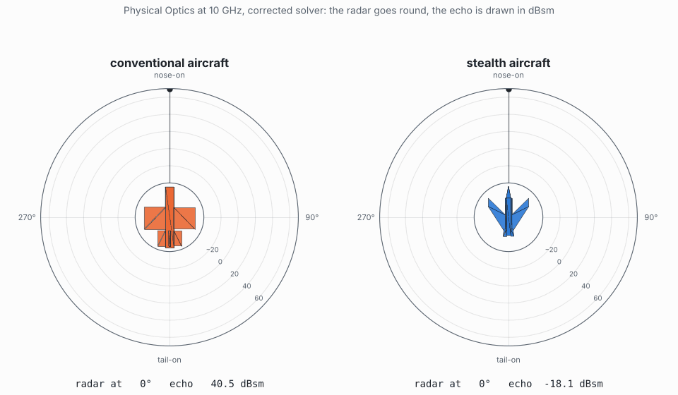<br>
<sub>The radar goes once round two of our aircraft and the echo is drawn as it goes, in dBsm (decibels
relative to one square metre). The conventional aircraft flashes whenever a flat face is square-on to the
radar; the stealth aircraft, whose faces are all tilted, sends back far less from the front.
Physical Optics at 10 GHz, with the corrected solver.</sub></p>

| | |
|---|---|
| **Question** | how much of a radar pulse each shape sends back, from every direction, and why |
| **Shapes** | a conventional aircraft, a stealth aircraft, a flying wing and a chined-nose fighter, each 18 to 32 flat triangles; a sphere and a flat plate as references |
| **Physics** | Physical Optics (each facet a mirror), edge diffraction, double and triple bounces, radar-absorbing materials; the exact Mie series for the sphere |
| **Extras** | frequency sweeps from 1 to 36 GHz, bistatic and polarimetric scattering, range profiles, ISAR images, a shape optimizer |
| **Built** | June 2026 with the free version of Claude; extended in July with another AI agent |
| **Checked** | November 2026, against answers known exactly. Some of what we had presented did not hold up, and the solver is corrected: [what we found](#what-we-checked-in-november-2026) |
| **Team** | three students, June and July 2026 |

---

## What radar cross section is

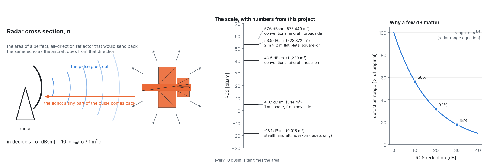

A radar sends out a pulse and listens. Whatever the pulse hits scatters it in all directions, and a tiny
part comes back. The radar cross section σ says how big the target looks to the radar: it is the area of
a perfect reflector, one that scatters equally in all directions, that would send back the same echo.
It depends on the direction, the frequency and above all the shape, much more than the size. Because it
spans many powers of ten, it is quoted in dBsm. And because a radar's detection range only grows as the
fourth root of σ, cutting the echo by 10 dB brings the detection range down to 56% of what it was.

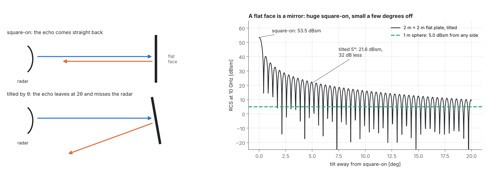

Shape matters because a flat face is a mirror. Square-on to the radar, our 2 m × 2 m plate sends back
53.5 dBsm, as much as a perfect reflector 224,000 m² in area. Tilt it 5° and the echo leaves at 10°,
missing the radar, and only 21.6 dBsm comes back: 32 dB less. A 1 m sphere, which has no flat faces,
returns 4.97 dBsm from every side. That is the idea behind stealth shaping: tilt every flat face away
from the directions a radar is likely to be, and get rid of the right-angle corners that act as
reflectors.

## The four aircraft

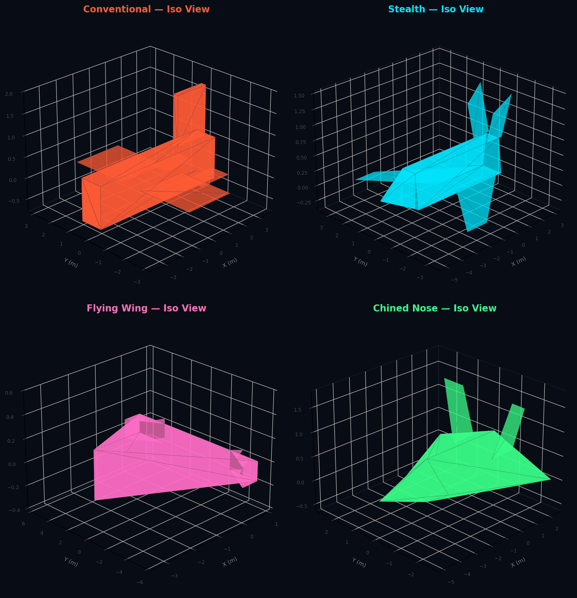

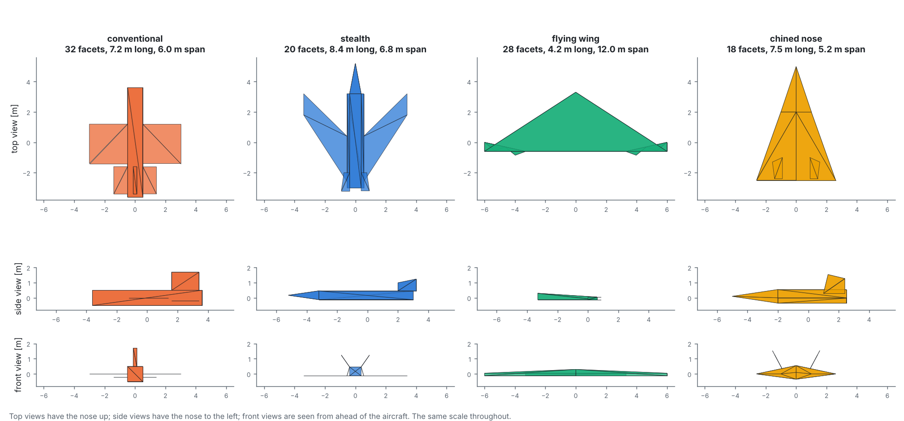

- **Conventional**: a box fuselage, straight wings and tail, a box fin, flat faces at right angles
  everywhere. The baseline.
- **Stealth**: a trapezoidal fuselage with tilted sides, a four-faced pointed nose, and two V-tails
  canted 35°. The slides call its wings 65° swept deltas and the code says they are swept back, but as
  built they sweep *forward* by about 45°, with the tips ahead of the roots (top view). We only noticed
  in November.
- **Flying wing**: no vertical surfaces at all, after the B-2.
- **Chined nose**: a diamond-section body blended into a delta wing, with twin canted tails, after
  fighters like the F-22. It has a flat back end, which is what lights it up from behind.

Every aircraft is a handful of big flat triangles, metres across. That keeps the computations fast, and
it is also why the numbers are those of flat mirrors, not of a real, curved aircraft.

## How it came together

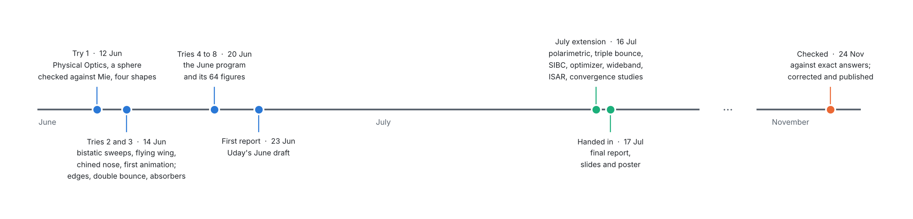

Most of it happened late at night. The first figures were saved at 4:49 in the morning on 12 June.

### 12 June: the first try

<p align="center">
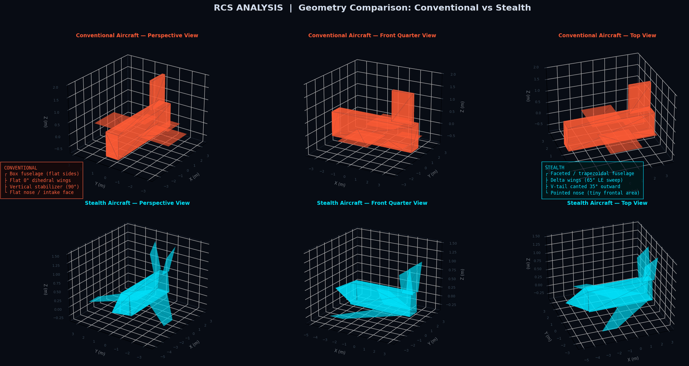
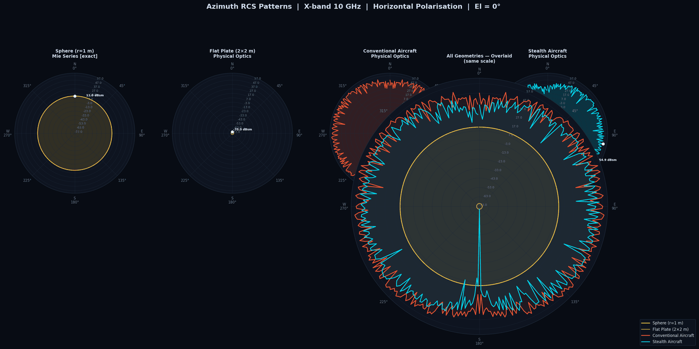<br>
<sub>The first two aircraft, and our first RCS polar plots: a sphere, a flat plate and the two aircraft, at 10 GHz.</sub></p>

The first try did Physical Optics on four shapes, a sphere, a plate and two aircraft, and checked the
sphere against the Mie series. In the same night it had polar plots,
[heatmaps](figures/june/first-tries/2026-06-12-first-heatmaps.png) over azimuth and elevation, a
[frequency sweep](figures/june/first-tries/2026-06-12-first-frequency-sweep.png) and a
[summary page](figures/june/first-tries/2026-06-12-first-summary.png).

### 14 June: more shapes, edges, corners, absorbers, and an animation

<p align="center">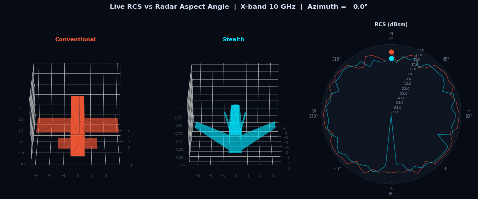<br>
<sub>Our first animation (14 June, 1:31 am): the two aircraft turning in front of the radar, with the echo
traced on the polar plot as they turn.</sub></p>

Two days later the program had the flying wing and the chined-nose aircraft
([six shapes](figures/june/first-tries/2026-06-14-six-shapes.png)),
[bistatic](figures/june/first-tries/2026-06-14-bistatic.png) sweeps with the receiver away from the
transmitter, and an [absorber coating](figures/june/first-tries/2026-06-14-absorber-coating.png). By that
morning it also had edge diffraction and double bounces between facets, shown level by level
([physics levels](figures/june/first-tries/2026-06-14-physics-levels.png),
[mechanism breakdown](figures/june/first-tries/2026-06-14-mechanism-breakdown.png),
[edge map](figures/june/first-tries/2026-06-14-edge-map.png),
[double-bounce map](figures/june/first-tries/2026-06-19-double-bounce-map.png)), and
[two kinds of absorber](figures/june/first-tries/2026-06-14-absorber-physics.png).

### 20 June: the June program

Tries 4 to 8 polished all of that into one program that draws 64 figures: the shapes from every side,
polar plots, heatmaps, frequency sweeps, absorbers, mechanism breakdowns and comparisons. On 23 June Uday
wrote it up as the first report.

<p align="center">
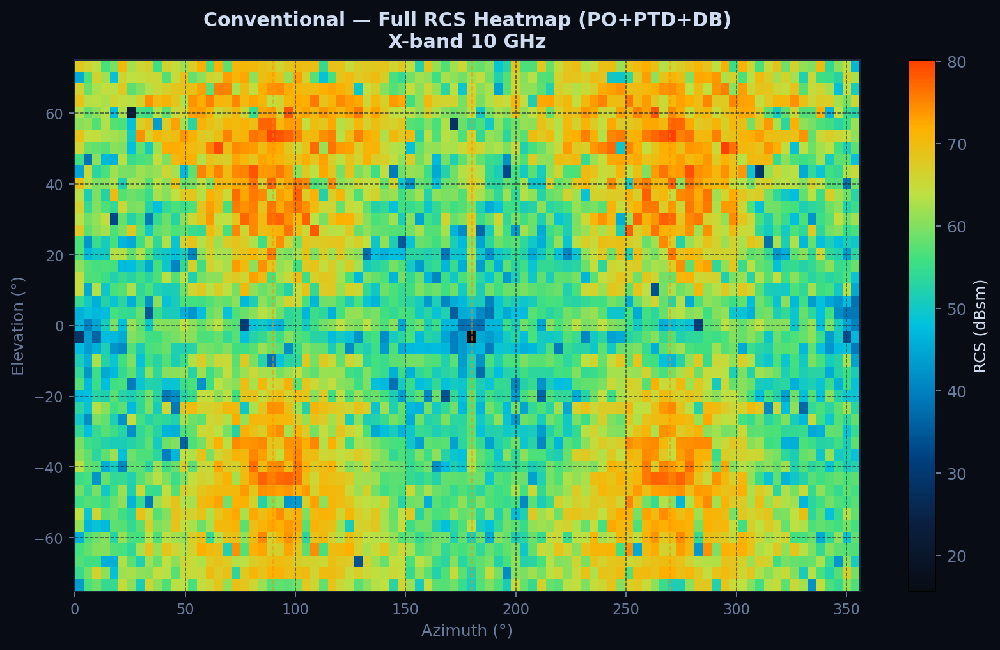
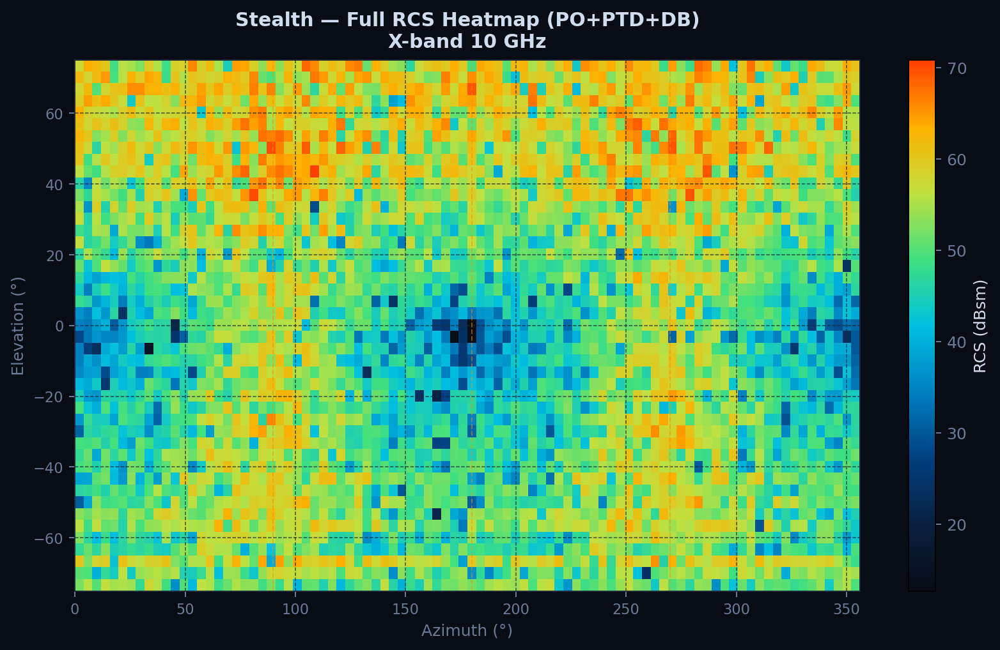<br>
<sub>RCS over every azimuth and elevation at 10 GHz, conventional and stealth aircraft, as made in June.</sub></p>

<p align="center">
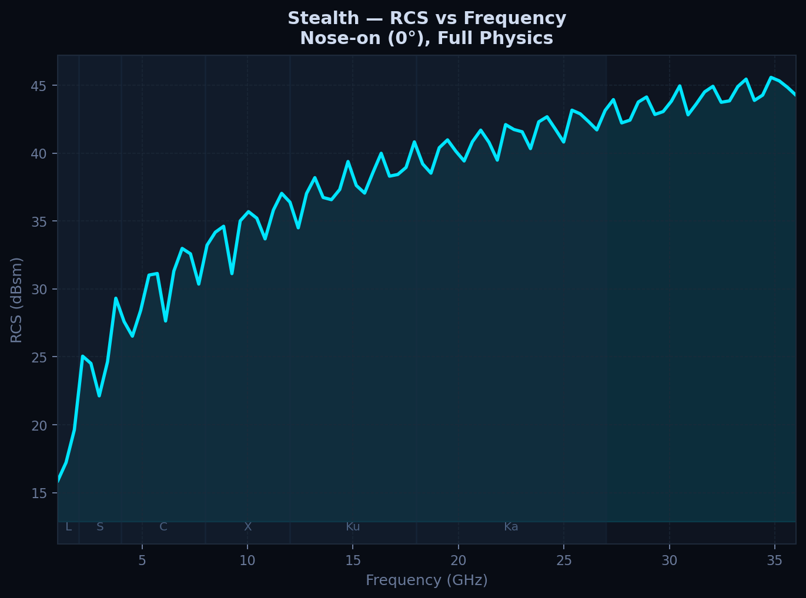
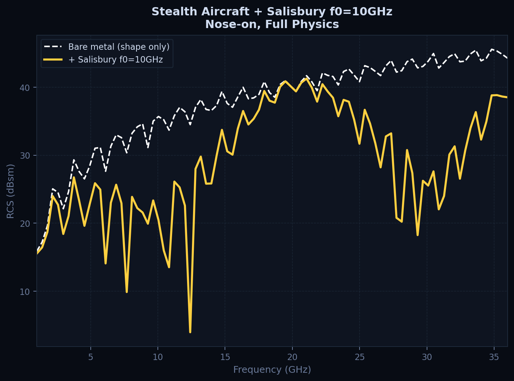<br>
<sub>Left: the stealth aircraft nose-on from 1 to 36 GHz. Right: the same aircraft with a Salisbury screen,
a resistive sheet a quarter-wavelength above the metal, which cancels the reflection at its design
frequency.</sub></p>

Everything else from June is in the [figure gallery](figures/README.md#june).

### July: Shanthosh takes it further

In July Shanthosh took the code much further with another AI agent: bistatic and polarimetric
scattering, triple bounces, surface-impedance models of real skin materials (aluminium, stainless steel,
titanium, carbon-fibre composite), a differential-evolution optimizer for the stealth shape, wideband
range profiles, ISAR images, and a mesh-convergence study for each. The last saves of the July code are
stamped between 10:38 pm on 16 July and 2:18 am on 17 July.

<p align="center">

<br>
<sub>Left: ISAR images, built from a sweep of 8 to 12 GHz over ±5° around broadside, which show where on each
aircraft the echo comes from. Right: the stealth shape's echo before and after the optimizer.</sub></p>

<p align="center">
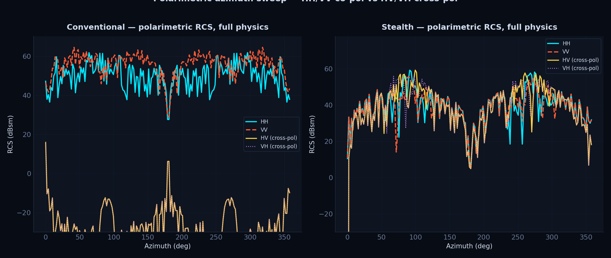
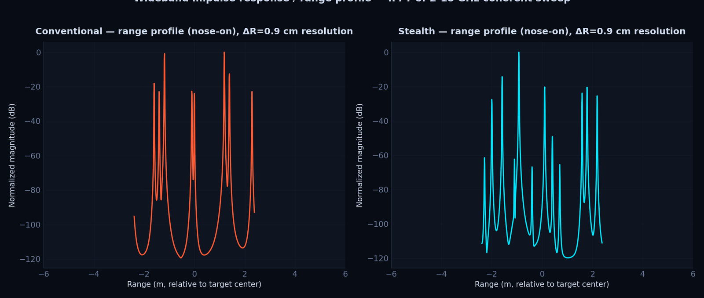<br>
<sub>Left: the echo in each polarization (HH, VV and the cross-polarized HV and VH). Right: range profiles,
the echo against distance along the line of sight.</sub></p>

All 21 July figures are in the [gallery](figures/README.md#july).

### 17 July: report, slides and poster

The slides were exported at 4:44 in the morning on 17 July, the report at 7:47 and the poster at 12:09.

<p align="center">
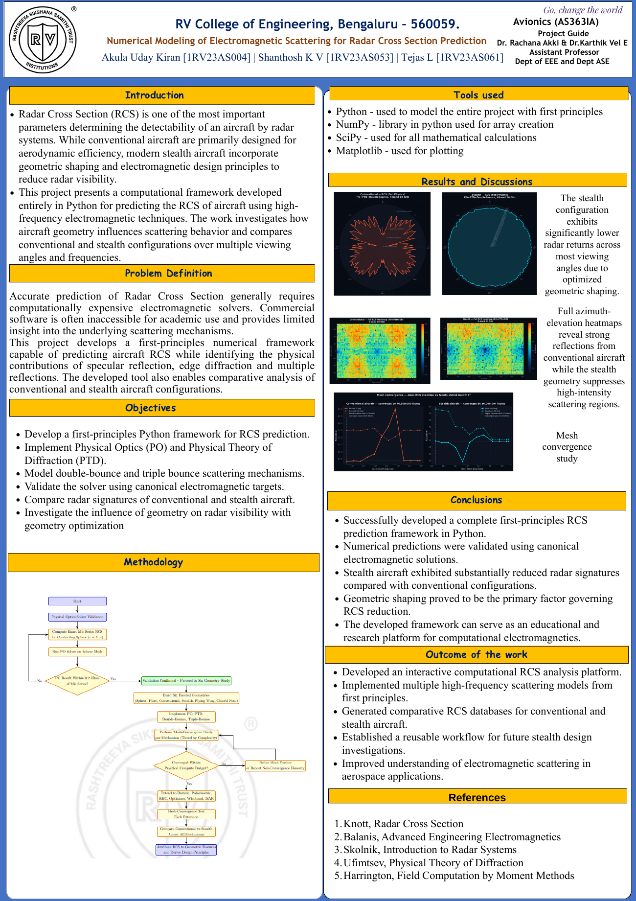
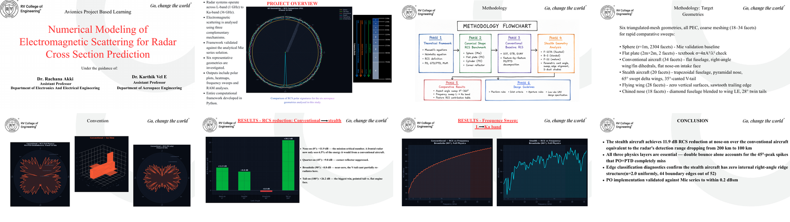<br>
<sub>The poster and eight of the slides. The slides, the poster and the 66-page report are in
<a href="report">report/</a>.</sub></p>

## What we presented

<p align="center"></p>

The headline was that the stealth aircraft returned 11.9 dB less than the conventional aircraft
nose-on, which would cut a radar's detection range from 200 km to 100 km. The report also said that the
Physical Optics solver matched the Mie series for a sphere to within 0.2 dBsm. Neither holds up.

## What we checked in November 2026

In November 2026, while putting the project on GitHub, we checked the solver against answers that are
known exactly.


1. **The sphere check had never passed.** The Mie series had a factor-of-4 slip (2n + 1 where
   n + ½ belongs), so for a 1 m sphere at 10 GHz it gave 10.99 dBsm instead of πa² = 4.97 dBsm. PO on the
   project's 2,304-facet sphere gave anything from 11.5 to 27.3 dBsm. *Fixed:* the Mie series gives
   4.97 dBsm, and PO now gives 2.9 to 6.0 dBsm on the same mesh and 4.7 to 5.2 on a 36,864-facet mesh
   (panel 2).

2. **Each facet was treated as a point.** The PO sum put a facet's whole area at its centre with a single
   phase. That only works for facets much smaller than a wavelength, and ours are 20 to 400 wavelengths
   across at 10 GHz. A big flat facet should send a narrow beam back when it faces the radar and very
   little otherwise; as a point it sent its full strength back from almost every angle. *Fixed:* the phase
   is now integrated exactly over each triangle (Gordon's closed form). A 2 m flat plate now follows the
   textbook formula exactly: 36.1 dBsm at 0.5° off normal and 21.6 dBsm at 5°, where the point model gave
   44.2 and 52.8 (panel 1).

   This is also what Shanthosh's July convergence study was seeing: as the facets were cut finer, the
   answers moved by more than 20 dB before settling, at millions of facets. For the conventional aircraft
   they settled at 46.9 dBsm (azimuth 0) and 57.6 dBsm (broadside), the same values the exact integral
   gives on the original June mesh. Panel 3 shows the same thing at 1 GHz, where the point model can get
   there with fewer facets. The stealth aircraft's azimuth-0 curve settled on a wrong value, because
   subdivision never splits its four nose triangles, so they were still points at the finest mesh.

3. **Azimuth 0 wasn't nose-on for every aircraft.** The models point their noses along −x and the program
   called azimuth 0 nose-on, but it put the radar on the +x side, behind the tail. Which side of a facet
   reflects depends on the order of its corners, and that was mixed: half of the stealth aircraft's facets
   and 16 of the flying wing's 28 faced inwards, which for the stealth aircraft happened to turn the view
   back to the front. The conventional aircraft also had a second copy of its flat nose face, facing into
   the fuselage. So "nose-on" meant the conventional aircraft seen from behind, plus that extra face,
   against the stealth aircraft seen from the front. *Fixed:* the radar direction, the duplicate face, and
   every facet's orientation (each now faces the side it can be seen from, found by casting rays).

4. **The double-bounce term counted bounces that can't happen.** It checked which way two facets faced but
   not where they were, so any pair at the right angles counted as a corner reflector. A plain 2 m cube
   cannot bounce a ray from one face to another, yet at 20°, 45° and 70° it got 61.7, 65.5 and 61.7 dBsm
   of "double bounce", more than the 53.5 dBsm flash from a face seen square-on. *Fixed:* the two facets
   must now face each other. *Still rough:* the term multiplies the two facet areas, so its size is wrong.
   A right-angle corner made of two 1 m plates should return 44.5 dBsm and gets 33.2; with 2 m plates,
   56.5 against 39.8.

5. **The edge term is not on the same footing as PO.** It adds an amplitude in m<sup>1.5</sup> to the
   facets' m², so how much the edges count against the facets depends on the units and the frequency.
   Not fixed.

6. **The stealth aircraft's wings sweep forward**, as above. We left the shape as it was designed in June.

So the corrected solver is right for the mirror-like part of the return (PO), and only roughly right for
edges and corners.

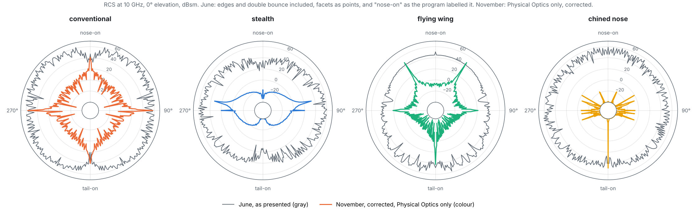

<sub>Gray: what we presented in June (edges and double bounces included, facets as points, and nose-on
where the program put it). Colour: the corrected Physical Optics. The June curves come from running the
June code in <a href="history/2026-06-20-june-final">history/</a>.</sub>

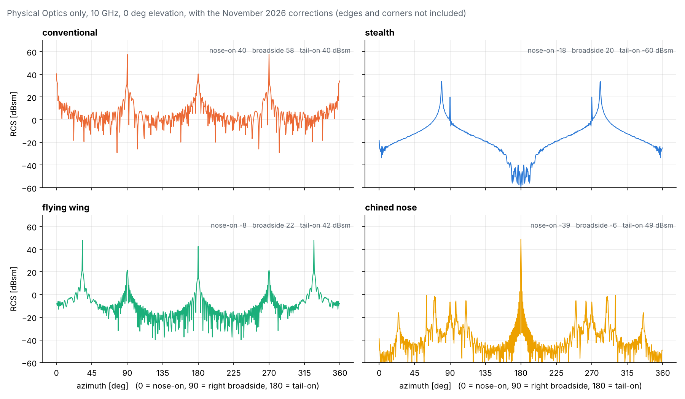

With the corrections, PO shows what shaping does to the mirror-like return. The conventional aircraft's
flat nose and flat sides are mirrors: 40.5 dBsm nose-on and 57.6 dBsm broadside. The stealth aircraft
returns −18.1 dBsm nose-on, because none of its faces points at the radar. Its real nose-on return would
come from edges, tips and gaps, which this model handles only roughly. So the 11.9 dB and the 200 km to
100 km do not stand, and this model can't give a better number in their place. The values for the
conventional aircraft are right for those flat boxes, but they are what metre-sized mirrors do; they say
nothing about a real, curved aircraft.

The July studies used the same model, so their numbers carry the same problems. Their figures are kept
as they were made. Their scripts run on the corrected solver, but we haven't rerun the long ones to the
end (ISAR, the optimizer, the wideband study and the convergence studies).

## What we learned

- Shaping works the way the slides said it does. Faces turned away from the radar send the energy
  elsewhere, and a flat face square-on to the radar is a mirror. The direction was right; the numbers
  weren't.
- Run the check and read the number. Our report said the sphere matched the Mie series; the code never
  did.
- The convergence study is where the problem first showed. An answer that moves by 20 dB when the mesh
  is refined isn't an answer yet.
- Draw the model and look at it. The stealth aircraft's wings swept the wrong way for five months, and
  one top view shows it.
- AI tools got us far and fast in a subject that was a mystery to us. They also wrote confident sentences
  about results we never checked. Checking is our job.

## Run it yourself

Python 3 with numpy, scipy and matplotlib (`pip install -r requirements.txt`). From `rcs/`:

```
python validate.py      # the November checks, about 10 s: figures/november/
python main.py          # the June set of 64 figures, with the corrections, about 30 s: rcs/output_ppt/
```

`RCS_FACET_INTEGRAL=centroid python main.py` runs with facets as points again. To reproduce the June
figures exactly, run `main.py` in [`history/2026-06-20-june-final`](history/2026-06-20-june-final).
The July study scripts (`advanced_study.py`, `sibc_comparison.py`, `stealth_optimizer.py`,
`wideband_impulse_response.py`, `isar_imaging.py`, and the convergence studies) run the same way and
write into `rcs/output_ppt/`. The bistatic, polarimetric and material studies take seconds; ISAR, the
optimizer and the wideband study take minutes. The convergence studies go up to tens of millions of
facets; the two biggest (`convergence_study.py` and `advanced_convergence_study.py`) run out of memory
on an 8 GB machine. From the top folder, `python tools/make_figures.py` redraws the explanatory figures
and the animation.

## What's in this repository

```
rcs/        the program, with the November corrections
              solvers.py      PO, edges, double and triple bounce, materials, Mie series
              geometries.py   the sphere, the plate and the four aircraft
              main.py         the June figure set
              validate.py     the November checks
              the rest        the July studies
figures/    june/ (with first-tries/) and july/ as made then; november/, explained/, presentation/
            and timeline.png from November. Every figure is captioned in figures/README.md
history/    the code as it was on 12, 14 and 20 June and 17 July 2026
report/     final report, slides and poster (17 July), the June draft, and errata
docs/       the two guides we learnt from
tools/      make_figures.py, which draws the explanatory figures and the animation
```

## The report

[`report/`](report/README.md) has the final report, *Numerical Modeling of Electromagnetic Scattering
for Radar Cross Section Prediction: A Computational Comparison of Conventional and Stealth Aircraft
Geometries* (66 pages), the slides and the poster, all from 17 July 2026, and Uday's June draft, exactly
as they were. Next to them is the list of what they get wrong.

---

## Team

**Akula Uday Kiran**, **Shanthosh K V** and **Tejas L**, Department of Aerospace Engineering,
RV College of Engineering, Bengaluru. Guided by **Dr. Rachana Akki**, Assistant Professor, Department of
Electronics and Electrical Engineering, and **Dr. Karthik Vel E**, Assistant Professor, Department of
Aerospace Engineering.

We worked it out together, and in July Shanthosh took it much further. Thank you to our guides, for
letting three aerospace students loose on a subject that was new to all of us.

This repository was put together in November 2026 from our project files. The checks, the corrected
solver, the explanatory figures, the animation and these notes were written then; the June and July
code, figures and documents are kept as they were.

## License

The code is MIT-licensed ([LICENSE](LICENSE)).
